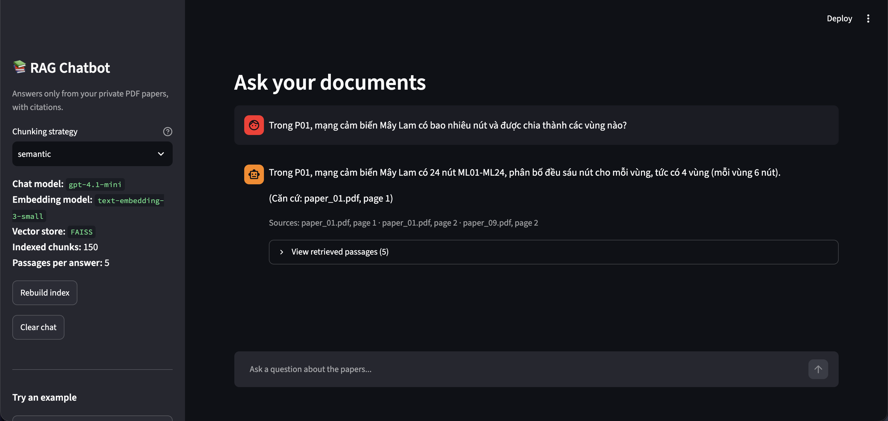
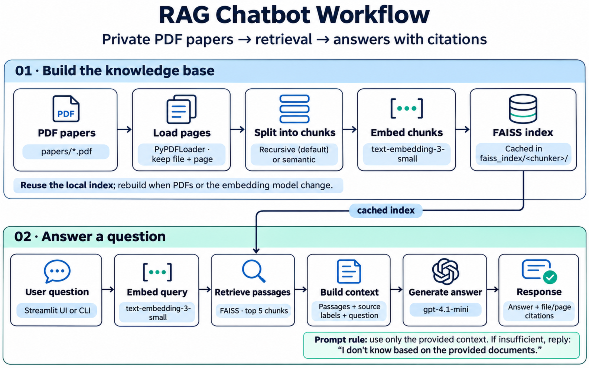

# RAG Chatbot over Private PDF Papers

A Retrieval-Augmented Generation (RAG) chatbot with a Streamlit web UI and a
command-line interface. It answers questions **only** from a private set of PDF
documents, cites the file and page of the passages it used, and refuses to answer when
the documents do not contain the answer.

Built with LangChain, OpenAI embeddings, FAISS and an OpenAI chat model.



## Why synthetic papers?

The knowledge base in `papers/` consists of 10 **fictional research papers** generated
with ChatGPT. Their content does not exist anywhere else, so a language model cannot
answer from its pre-trained knowledge. If the chatbot answers correctly, it is genuinely
retrieving from the documents, and if it is asked about something outside them, it
should say it does not know. This makes retrieval quality and hallucination resistance
easy to test.

The papers and the test questions are written in Vietnamese, so the pipeline is also
tested on non-English text.

## Features

- **Streamlit chat UI** with streaming answers, expandable retrieved passages, chunking
  strategy selection, index rebuild and example questions.
- **Two chunking strategies**: `RecursiveCharacterTextSplitter` (default, 1200
  characters with 200 overlap) and `SemanticChunker`, selectable in the UI or with
  `--chunker`.
- **Persistent FAISS index**: embeddings are computed once and cached per chunker in
  `faiss_index/`; the index is rebuilt automatically when the PDFs change.
- **Grounded answers with citations**: the model cites `(file, page N)` and the UI lists
  the retrieved passages.
- **Strict refusal behaviour**: when the context does not contain the answer, the bot
  replies *"I don't know based on the provided documents."*
- **Evaluation suite** with 100 hand-written test cases (answerable and out-of-scope):
  runs in parallel, validates the test file, saves a per-question JSON report, gives 95%
  confidence intervals and compares the two chunkers side by side.
- **Debug mode** that prints retrieved chunks with their distances.

## Project structure

```text
rag_chatbot/
├── src/
│   ├── chatbot.py          # indexing, retrieval chain and CLI
│   ├── app.py              # Streamlit web UI
│   └── evaluate.py         # evaluation harness
├── eval/
│   ├── eval_questions.json # 100 test cases
│   └── results/            # per-question evaluation reports
├── papers/                 # PDF knowledge base
├── assets/                 # workflow diagram and screenshot
├── .env.example            # template for your OpenAI API key
├── .gitignore
├── requirements.txt
└── README.md
```

## Getting started

**Prerequisites:** Python 3.10+ and an
[OpenAI API key](https://platform.openai.com/api-keys). The PDFs are already in `papers/`.

```bash
# 1. Clone the repository
git clone https://github.com/ancodetest08/rag_chatbot.git
cd rag_chatbot

# 2. Create and activate an environment
conda create -n rag_chatbot python=3.12 -y
conda activate rag_chatbot
# ...or with venv:
#   python -m venv .venv
#   source .venv/bin/activate        # Windows: .venv\Scripts\activate

# 3. Install dependencies
pip install -r requirements.txt

# 4. Add your API key
cp .env.example .env                 # Windows: copy .env.example .env
# then open .env and set OPENAI_API_KEY

# 5. Launch the web UI
streamlit run src/app.py

# ...or use the command-line version
python src/chatbot.py
```

The first run builds the index (this calls the OpenAI embeddings API). Later runs load
it from disk instantly.

### Command-line options (`src/chatbot.py`)

| Flag                            | Description                                |
| ------------------------------- | ------------------------------------------ |
| `--chunker recursive\|semantic` | Chunking strategy (default: `recursive`)   |
| `--rebuild`                     | Force rebuilding the index                 |
| `--debug`                       | Print retrieved chunks and their distances |

## Example

```text
Question: Hệ thống Lối Bạc khảo sát bao nhiêu phòng và các phòng được đánh mã như thế nào?

Hệ thống Lối Bạc khảo sát 12 phòng học và không gian nhóm, các phòng được đánh mã từ L01 đến L12 (paper_04.pdf, page 1).

Sources: paper_04.pdf, page 1 · paper_04.pdf, page 2 · paper_06.pdf, page 2

Question: Hôm nay Đà Nẵng có mưa không?

I don't know based on the provided documents.
```

## How it works



1. **Load**: `PyPDFLoader` reads every PDF in `papers/` page by page, keeping file name
   and page number as metadata.
2. **Chunk**: by default `RecursiveCharacterTextSplitter` (1200 characters, 200
   overlap). Alternatively `SemanticChunker`, which embeds sentences and splits where
   the distance between neighbours exceeds the 85th percentile.
3. **Embed and index**: chunks are embedded with `text-embedding-3-small` and stored in
   FAISS (saved to disk, one index per chunker).
4. **Retrieve**: the question is embedded and the top 5 closest chunks are fetched.
5. **Generate**: the chunks are formatted as `[file, page N] text` and passed to
   `gpt-4.1-mini` with a prompt that forbids outside knowledge and requires citations.
6. **Respond**: the answer is shown together with the labels of the retrieved passages.

## Evaluation

`eval/eval_questions.json` holds 100 hand-written test cases of two kinds:

- **Answerable**: the answer is in the papers. The check passes if the answer is not a
  refusal and contains every expected keyword. Text keywords ignore case, spaces and
  commas; numeric keywords (`"5"`, `"2,9"`, `"1.000"`) must match as whole numbers, so
  `"5"` does not match `"15"`.
- **Unanswerable**: the answer is not in the papers. The check passes if the bot
  refuses.

```json
[
  {
    "question": "...",
    "answerable": true,
    "must_contain": ["keyword1", "keyword2"]
  },
  {
    "question": "...",
    "answerable": false
  }
]
```

```bash
python src/evaluate.py                    # default chunker (recursive)
python src/evaluate.py --chunker semantic
python src/evaluate.py --chunker all      # both chunkers
python src/evaluate.py --limit 10         # quick run on the first 10 cases
python src/evaluate.py --workers 4        # run with 4 parallel workers
```

Questions are answered in parallel (`--workers`, default 8). Every run writes a
per-question report (answer, retrieved sources, reason for each failure) to
`eval/results/<chunker>.json`, and the console shows 95% confidence intervals.

Setup: `gpt-4.1-mini` at temperature 0, `text-embedding-3-small`, top-5 retrieval.

| Chunker             | Answerable  | Unanswerable (refusal) | Overall      |
| ------------------- | ----------- | ---------------------- | ------------ |
| Recursive (default) | 58/77 (75%) | 20/23 (87%)            | 78/100 (78%) |
| Semantic            | 64/77 (83%) | 16/23 (70%)            | 80/100 (80%) |

95% confidence intervals:

| Chunker             | Answerable | Unanswerable (refusal) | Overall |
| ------------------- | ---------- | ---------------------- | ------- |
| Recursive (default) | 65%–84%    | 68%–95%                | 69%–85% |
| Semantic            | 73%–90%    | 49%–84%                | 71%–87% |

Semantic chunking is slightly ahead overall (+2 points, driven by 6 more correct
answerable questions), while recursive chunking refuses out-of-scope questions slightly
more reliably (+4 question). The confidence intervals overlap almost completely in every
column, so with only 100 test cases (23 unanswerable) the two chunkers cannot be told
apart statistically.

## Design decisions

- **Recursive chunking as the default** (1200 characters, 200 overlap): on the
  evaluation set the two chunkers are statistically indistinguishable (78% vs 80%
  overall, overlapping confidence intervals; see the table above), so the simpler option
  is kept. It needs no extra embedding calls while chunking, and it refuses out-of-scope
  questions slightly more often (87% vs 70%). On this corpus semantic chunking produced
  about twice as many chunks (150 vs 82), i.e. smaller passages, so a fixed top-5 gives
  the model less context per answer.
- **Semantic chunking kept as an option**: it scored slightly higher on answerable
  questions (83% vs 75%), though not significantly, and may behave differently on other
  corpora.
- **Non-reasoning chat model with `temperature=0`**: gives stable, reproducible answers
  for a factual QA task.
- **L2 distance in FAISS**: OpenAI embeddings are normalised to unit length, so L2
  ranking is equivalent to cosine ranking.
- **Index cache with a fingerprint**: the index stores a hash of the PDFs, so it is
  rebuilt only when documents change.

## Known limitations

- Single-turn: the bot does not remember previous questions, even though the UI shows
  the chat history.
- Always retrieves the top 5 chunks and relies on the prompt (not a similarity
  threshold) to refuse out-of-scope questions.
- The "Sources" line lists the retrieved passages, which may include passages the model
  did not use.
- The refusal message is always in English, even for Vietnamese questions.
- `PyPDFLoader` extracts text only; tables, figures and scanned PDFs are not handled.
- Evaluation uses keyword matching, a coarse proxy for answer quality, and the test set
  was written by the author.

## Possible next steps

- Conversation memory and query rewriting for follow-up questions
- Deploy the demo (e.g. Streamlit Community Cloud)
- Hybrid retrieval (BM25 + vectors) and a re-ranker
- LLM-as-a-judge evaluation and retrieval metrics (hit rate, MRR)
